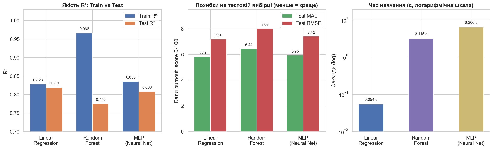
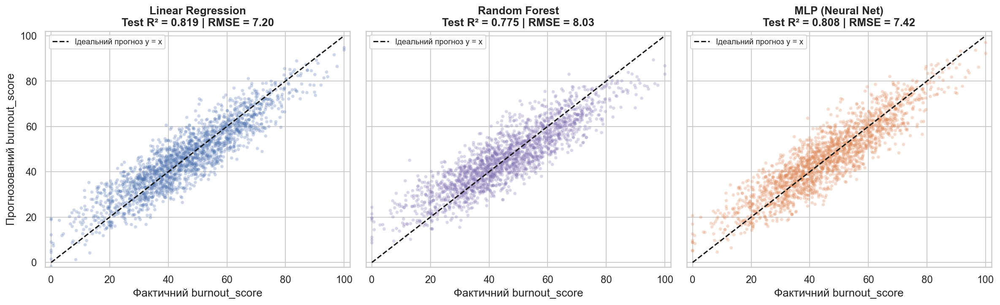
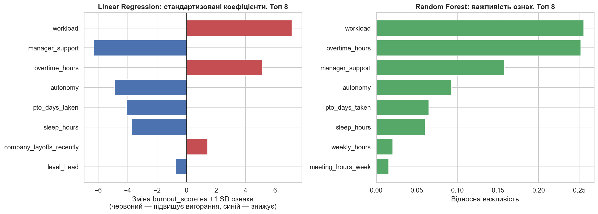

# Прогнозування рівня вигорання працівників: порівняння моделей машинного навчання

**Дисципліна:** Основи штучного інтелекту  
**Виконала:** Захарук Софія, КН-3

## Загальний опис проєкту
Цей проєкт присвячений дослідженню та порівнянню трьох моделей машинного навчання різної складності на задачі регресії — прогнозуванні індексу професійного вигорання працівників (`burnout_score`, шкала від 0 до 100). Для експерименту використано синтетичний табличний датасет Employee Burnout & Attrition Prediction (10k) із платформи Kaggle, який моделює показники працівників середньої компанії.

Головна мета роботи - натренувати на однакових даних просту, середню та складну моделі, виміряти їхню швидкість навчання й прогнозування, оцінити якість і схильність до перенавчання, а також визначити, які робочі фактори найбільше впливають на вигорання.

## Датасет та підготовка даних
Вибірка складається з **10 000 записів** та **20 колонок** без пропущених значень. Оскільки датасет містить дві результуючі змінні — `burnout_score` (рівень вигорання) та `attrition_12m` (факт звільнення протягом року), перед початком навчання я очистила набір ознак, щоб уникнути **витоку цільової змінної (Target Leakage)**:

- видалено колонку `employee_id` як технічний ідентифікатор, що не несе закономірностей;
- видалено `attrition_12m`, оскільки звільнення є наслідком вигорання і не може бути відоме наперед.

У результаті для прогнозування `burnout_score` залишилося 17 вхідних ознак (навантаження, понаднормові години, підтримка менеджера, автономність, тривалість сну, кількість днів відпустки, відділ, рівень посади тощо). Дані розбито на навчальну (80%, 8 000 рядків) та тестову (20%, 2 000 рядків) вибірки.

Для підготовки ознак використано `ColumnTransformer`:
- 15 числових ознак стандартизовано через `StandardScaler` (приведення до середнього $\mu = 0$ та стандартного відхилення $\sigma = 1$), що критично для коректної роботи нейромережі та дозволяє напряму порівнювати ваги лінійної моделі;
- 2 категоріальні ознаки (`department` та `level`) закодовано через `OneHotEncoder(drop="first")`, що перетворило текстові категорії у бінарні стовпці без мультиколінеарності (разом — 28 ознак на вході моделей).

## Алгоритмічна складова (3 моделі різної складності)
Для порівняння обрано три принципово різні підходи регресії з бібліотеки `scikit-learn`:

1. **Лінійна регресія (`LinearRegression` — проста модель)**
   Шукає одну лінійну залежність між вхідними ознаками та рівнем вигорання у вигляді зваженої суми $\hat{y} = w_0 + \sum_{i=1}^{n} w_i x_i$. Ваги підбираються методом найменших квадратів (мінімізація суми квадратів похибок). Через те що розв'язок знаходиться аналітично (матрично), модель навчається майже миттєво, легко інтерпретується та має низький ризик перенавчання, але не здатна вловлювати складні нелінійні взаємодії.

2. **Випадковий ліс (`RandomForestRegressor` — модель середньої складності)**
   Ансамблевий алгоритм на основі беґінгу (*bagging*), який об'єднує 200 незалежних дерев рішень із максимальною глибиною `max_depth=15`. Кожне дерево навчається на власній випадковій бутстреп-підвибірці та розбиває дані пороговими правилами так, щоб максимально зменшувати дисперсію (MSE) цільової змінної. Фінальний прогноз формується як середнє арифметичне відповідей усіх 200 дерев. Модель добре моделює нелінійні залежності, проте схильна запам'ятовувати шум на навчальних даних і повільніше робить прогнози.

3. **Багатошаровий перцептрон (`MLPRegressor` — складна модель / нейромережа)**
   Повнозв'язна нейронна мережа прямого поширення з двома прихованими шарами на 128 та 64 нейрони і функцією активації $\text{ReLU}(z) = \max(0, z)$. Навчання відбувається ітеративно міні-батчами по 64 приклади алгоритмом зворотного поширення похибки з оптимізатором `Adam`. Щоб уникнути перенавчання, у модель додано $L_2$-регуляризацію (`alpha=1.0`) та механізм ранньої зупинки (`early_stopping=True`), який автоматично припиняє тренування, коли якість на валідаційній частині перестає зростати.

## Результати експерименту та порівняльний аналіз
Для оцінки якості використано метрики MAE (середня абсолютна похибка в балах), RMSE (корінь із середньоквадратичної похибки, чутливий до великих промахів) та $R^2$ (коефіцієнт детермінації — частка поясненої дисперсії). Для перевірки стабільності додатково проведено 5-кратну крос-валідацію (`CV R2`) на навчальній вибірці.

| Модель | Складність | Час навчання (с) | Train MAE | Test MAE | Train RMSE | Test RMSE | Train $R^2$ | Test $R^2$ | 5-fold CV $R^2$ |
| :--- | :--- | :---: | :---: | :---: | :---: | :---: | :---: | :---: | :---: |
| **Linear Regression** | Проста | **0.054** | 5.54 | **5.79** | 6.91 | **7.20** | 0.828 | **0.819** | **0.826 $\pm$ 0.007** |
| **Random Forest** | Середня | 3.115 | 2.47 | 6.44 | 3.07 | 8.03 | 0.966 | 0.775 | 0.778 $\pm$ 0.003 |
| **MLP (Neural Net)** | Складна | 6.300 | 5.42 | 5.95 | 6.75 | 7.42 | 0.836 | 0.808 | 0.812 $\pm$ 0.007 |







### Ключові висновки за результатами
- **Перемога найпростішої моделі (принцип бритви Оккама):** `Linear Regression` продемонструвала найкращу якість на тестових даних ($R^2 = 0.819$, середня похибка $\text{MAE} = 5.79$ бала зі 100) і водночас навчилася у 58 разів швидше за `Random Forest` та у 117 разів швидше за нейромережу `MLP`. Це пояснюється природою датасету: залежність `burnout_score` від ключових факторів є переважно лінійною з додаванням випадкового шуму (близько 18% дисперсії).
- **Перенавчання (Overfitting) у Random Forest:** на навчальній вибірці ліс досягає $R^2 = 0.966$, проте на тесті якість різко падає до $R^2 = 0.775$ (найгірший результат серед трьох моделей). Глибокі дерева намагаються відтворити плавну лінійну залежність «сходинками» і запам'ятовують шум, а на графіку `Actual vs Predicted` додатково помітний більший розкид точок і гірша екстраполяція на крайніх значеннях (біля 0 та 100). Крім того, обхід 200 дерев робить інференс найповільнішим (понад 100 мс на 2 000 записів проти 10 мс в інших моделей).
- **Нейромережа (MLP) як компроміс без переваги в точності:** завдяки $L_2$-регуляризації та `early_stopping` мережа практично не перенавчається (розрив між Train і Test $R^2$ становить лише 0.028) і майже наздоганяє лінійну регресію ($R^2 = 0.808$), при цьому швидко виконує прогноз через матричні множення. Втім, у понад сто разів довше навчання не дає виграшу в точності там, де в даних немає складних нелінійних зв'язків.
- **Найвпливовіші фактори вигорання:** обидві інтерпретовані моделі (`Linear Regression` та `Random Forest`) впевнено виділяють одну й ту саму шістку ключових чинників. Найсильніше підвищують вигорання загальне робоче навантаження (`workload`), понаднормові години (`overtime_hours`) та нещодавні скорочення в компанії (`company_layoffs_recently`). Найефективніше знижують вигорання підтримка менеджера (`manager_support`), автономність у роботі (`autonomy`), використані дні відпустки (`pto_days_taken`) та достатня тривалість сну (`sleep_hours`).

## Архітектура скрипту та технічні рішення
Проєкт реалізовано на Python у вигляді єдиного відтворюваного скрипту `burnout_models.py`. Під час розробки я застосувала кілька важливих практик машинного навчання:

- **Інкапсуляція у `Pipeline`:** об'єднання препроцесингу (`StandardScaler`, `OneHotEncoder`) і моделі в єдиний конвеєр гарантує, що параметри масштабування обчислюються виключно на навчальних даних (включно з кожним окремим фолдом під час крос-валідації). Це повністю унеможливлює витік статистики з тесту.
- **Точний бенчмаркінг та відтворюваність:** для вимірювання часу навчання й прогнозування використано високоточний таймер `time.perf_counter()`, а фіксація `random_state=42` у розбитті даних і моделях забезпечує стабільну відтворюваність метрик.
- **Автоматична генерація артефактів звіту:** після кожного запуску скрипт автоматично виводить зведену таблицю в консоль, зберігає її у форматі CSV (`burnout_model_comparison.csv`) та будує три графіки високої роздільної здатності (`150 dpi`) для візуального аналізу.

## Інструкція із запуску
Для роботи скрипту потрібен Python 3.x та бібліотеки аналізу даних і візуалізації:

```bash
pip install numpy pandas scikit-learn matplotlib seaborn
```

Помістіть файл датасету `employee_burnout_attrition.csv` в одну директорію зі скриптом та запустіть:

```bash
python burnout_models.py
```

Після завершення роботи в поточній папці буде створено таблицю `burnout_model_comparison.csv` і три графіки: `model_comparison_metrics.png`, `actual_vs_predicted.png` та `feature_importance.png`.
